  

  

    
    
    
  

---

### 👨‍💻 About Me

- 🎓 **2nd-Year Computer Science Undergraduate** at **National Institute of Technology Calicut (NITC)**.
- ⚡ **Systems & Low-Level Foundations**: **C is my primary language** — building high-performance logic, simulation mechanics, and exploring system-level design.
- ☕ **Object-Oriented & Problem Solving**: Actively working with **Java**, **C++**, and **Data Structures & Algorithms (DSA)**.
- 🌐 **Full-Stack Web Development**: Designing and shipping end-to-end web applications with clean, responsive frontends and functional backends.
- 🎨 **Creative Tech & 3D**: Modeling, lighting, and creating 3D visual designs using **Blender**.
- 🧭 **Exploring the Frontier**: Experimenting across diverse stacks to pinpoint the exact engineering domain I want to specialize in long-term.

---

### 🛠️ Tech Stack & Skills

<table>
  <tr>
    <td align="center" width="160"><strong>Core Languages</strong></td>
    <td>
      
      
      
      
      
      
      
    </td>
  </tr>
  <tr>
    <td align="center"><strong>CS & Foundations</strong></td>
    <td>
      
      
      
    </td>
  </tr>
  <tr>
    <td align="center"><strong>Web & Full Stack</strong></td>
    <td>
      
      
      
      
    </td>
  </tr>
  <tr>
    <td align="center"><strong>Creative & Tools</strong></td>
    <td>
      
      
      
      
      
      
    </td>
  </tr>
</table>

---

### 🌟 Featured Projects & Explorations

| Project | Description | Core Stack |
| :--- | :--- | :--- |
| 🦇 **[Project BAT](https://github.com/aabidachikte/project_bat)** | Stealth-puzzle game navigating pitch-black labyrinths using grid-based echolocation. **C** executes the real-time acoustic sonar physics engine, while JavaScript renders neon-radar visuals on HTML Canvas. | `C (Physics Core)` `JavaScript` `Canvas` `Simulation` |
| 🎯 **[NITC Wordle](https://github.com/aabidachikte/nitc-wordle)** | Campus Wordle clone developed for FOSS Cell NITC. Dynamic keyword sync from the live campus MediaWiki Action API with interactive frontend gameplay. | `Web App` `MediaWiki API` `Game Logic` |
| 🌐 **[SMP Global Website](https://github.com/aabidachikte/smp-global-website)** | Responsive corporate web application featuring modern styling, accessibility, and high-performance frontend architecture. | `HTML5` `CSS3` `JavaScript` `Responsive Design` |
| ⚡ **[IEEE SB NITC](https://github.com/aabidachikte/ieee-sb-nitc)** | Digital presence and community portal for IEEE Student Branch National Institute of Technology Calicut. | `Web Architecture` `Community Platform` |
| 🚀 **[Anautilus LLP](https://github.com/aabidachikte/anautilus-llp)** | Commercial website and brand identity showcase built for desktop and mobile viewports. | `Frontend UI` `Responsive Design` |
| 🎨 **3D & Creative Tech** | Creating 3D scenes, procedural assets, and visual experimentations using Blender. | `Blender 3D` `Creative Tech` `Shading & Lighting` |

---

### 📊 GitHub Activity & Analytics

  
  

  

---

### 🤝 Let's Connect!

  
  

   
  ⚡ <i>"Talk is cheap. Show me the code."</i> — Linus Torvalds

